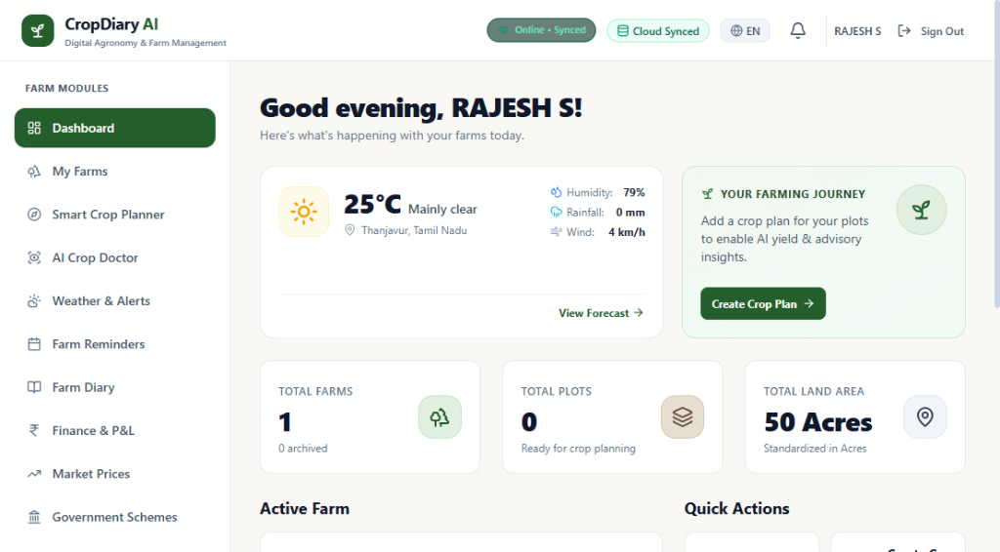
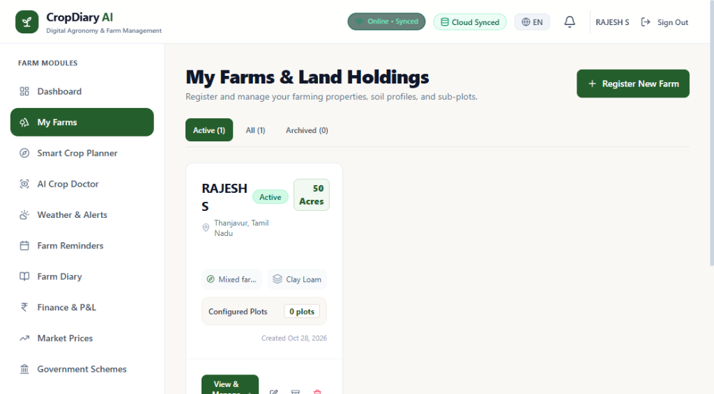
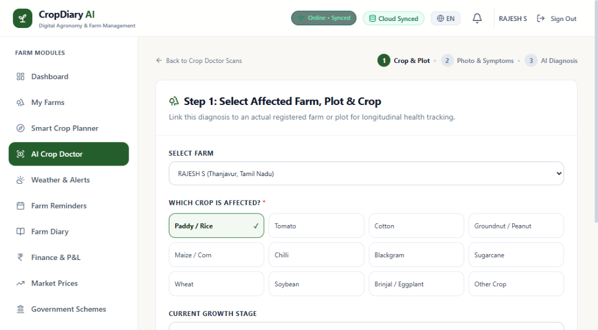
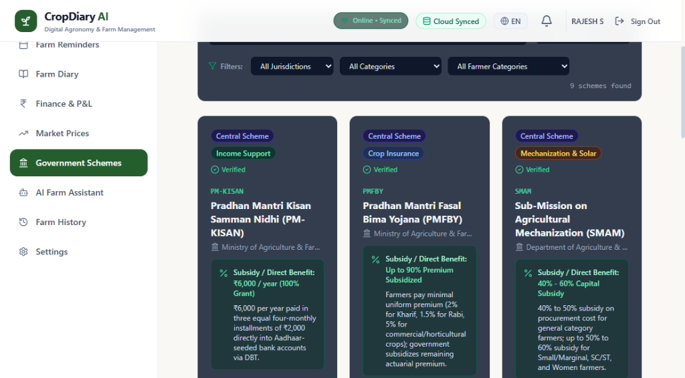
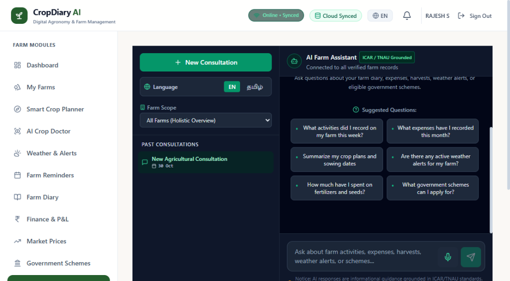
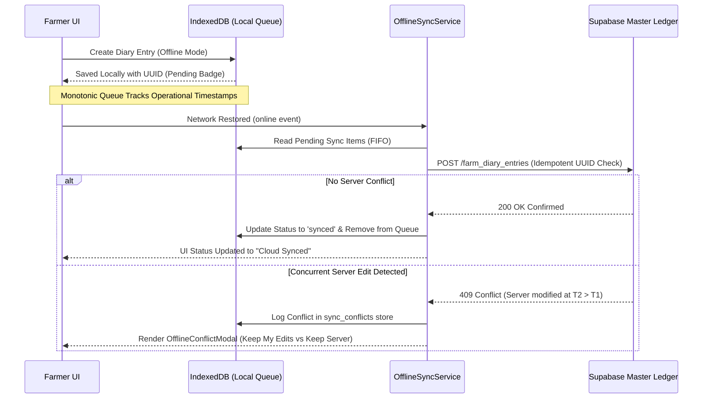

# CropDiary AI — Intelligent Farm Management Platform
*Autonomous, Offline-First Digital Companion & Precision Agronomic Ledger for Indian Agriculture*

[](tests/)
[](dist/)
[](src/)
[](https://deepmind.google/technologies/gemini/)
[](https://supabase.com/)
[](LICENSE)

<p align="center">
  
</p>

---

## 1. Executive Summary & Problem Statement

Smallholder and medium-scale farmers in India routinely navigate fragmented operational workflows:
- **Sowing decisions** are often driven by hearsay rather than localized agro-climatic, soil, and historical performance parameters.
- **Plant diseases and pests** are frequently diagnosed late or treated incorrectly, leading to excessive chemical sprays that escalate costs and degrade soil ecosystems.
- **Field expenditures, input dosages, daily wages, and harvest sales** are kept on loose slips or unrecorded, obscuring unit cultivation costs per acre.
- **Rural fields suffer frequent cellular dropouts**, causing conventional cloud-only apps to fail at the moment of need.

**CropDiary AI** solves this fragmentation through an offline-first, multilingual agricultural intelligence platform. By unifying crop planning, field diaries, disease pathology, meteorological spray alerts, integer paise financial bookkeeping, mandi price discovery, and government subsidy matching into a single responsive interface, CropDiary AI equips farmers with data-driven decision power from pre-sowing to post-harvest.

---

## 2. Integrated Feature Architecture across 10 Core Modules

| Module | Route | Core Capabilities |
|---|---|---|
| **1. Dashboard & Farms** | `/dashboard`, `/farms` | Hierarchical farm-plot data model, multi-plot boundary management, regional land unit conversions (Acres, Hectares, Gunthas, Bighas), and multi-tenant PostgreSQL Row-Level Security (RLS) isolation. |
| **2. Smart Crop Planner** | `/crop-planner` | Explainable agronomic engine scoring 10+ crops based on soil pH, seasonal rainfall, crop duration, and plot-scaled cultivation budgets. |
| **3. AI Crop Doctor** | `/crop-doctor` | Multimodal plant pathology cross-referencing ICAR/TNAU symptom matrices. Enforces non-chemical Integrated Pest Management (IPM) priority and strictly prohibits WHO Class Ia/Ib toxic pesticides. |
| **4. Weather & Smart Alerts** | `/weather`, `/reminders` | Hyperlocal Open-Meteo forecasts, WMO meteorological code decoding, wind/precipitation spray feasibility indices, and proactive weather reminders. |
| **5. Smart Farm Diary** | `/diary` | Chronological farm journal tracking operations across 6 categories (activities, inputs, irrigation, observations, expenses, harvests) with hashtag searching. |
| **6. Farm Finance & Mandi Prices** | `/finance`, `/market-prices` | Minor-unit integer paise arithmetic ($0.01\text{ INR} = 1\text{ paise}$), area-weighted overhead allocations, Agmarknet/DMI price benchmarks, and transport net margin arbitrage. |
| **7. AI Farm Assistant** | `/assistant` | Bilingual voice and text assistant powered by **Google Gemini 2.5 Flash** (via server-side Supabase Edge Functions) with verified local ICAR/TNAU agronomic fallback. |
| **8. Government Schemes Matcher** | `/schemes` | 18 Central and State schemes (PM-KISAN, PMFBY, SMAM, Kalaignar Scheme) with verified `.gov.in`/`.nic.in` portal links and 1-click reminder scheduling. |
| **9. Multi-Season Farm History** | `/history` | Longitudinal season comparison tracking yield per acre, cost of cultivation per quintal, net margin trends, CSV export, and print stylesheets. |
| **10. Offline Sync Engine** | *Global Shell* | Browser-native IndexedDB client, network status monitor, idempotent sync queue, and visual side-by-side conflict resolution modal. |

---

## 3. Platform Screenshots & Visual Walkthrough

### Unified Farmer Dashboard & Land Holdings Management
| Farm Overview & Weather Telemetry | Multi-Farm & Plot Area Management |
|:---:|:---:|
|  |  |
| *Real-time WMO weather forecast, cloud sync status, farm metrics, and one-tap agronomic actions.* | *Plot management, soil profile categorization (Clay Loam), and regional land standardization.* |

### Diagnostic Pathology & Verified Agricultural Welfare
| Step-by-Step AI Crop Doctor Scan | Central & State Government Schemes Matcher |
|:---:|:---:|
|  |  |
| *Multimodal symptom identification across 10+ crops with WHO Class Ia/Ib pesticide bans.* | *18 verified welfare schemes (PM-KISAN, PMFBY, SMAM) with transparent eligibility details.* |

### Bilingual AI Farm Assistant
<p align="center">
  
  <br />
  <em>Voice- & text-enabled AI assistant powered by Google Gemini 2.5 Flash via Supabase Edge Function with ICAR/TNAU domain grounding in English and Tamil (தமிழ்).</em>
</p>

---

## 4. Technology Stack

- **Frontend Core**: React 18, TypeScript 5.6, Vite 6.0, Tailwind CSS, Lucide Icons.
- **State & Data Management**: React Context, TanStack React Query v5, React Router v6, React Hook Form, Zod v3.
- **Offline Storage**: Native browser IndexedDB (`idb` transactional client) with monotonic operational queues and local storage adapters.
- **Backend & Cloud Database**: Supabase Cloud PostgreSQL with Row-Level Security (RLS) policies; zero-dependency local storage fallback adapter for isolated offline development.
- **Agentic AI & Serverless Edge Functions**: 
  - **Google Gemini 2.5 Flash** executed server-side via Supabase Edge Function (`supabase/functions/gemini-assistant/index.ts`).
  - Embedded **ICAR/TNAU Agricultural Rulebase** ensuring 100% deterministic, offline-capable responses in Tamil (`ta-IN`) and English (`en-IN`).
- **External Data Providers**: Open-Meteo API (weather & spray windows), Open Data Government API / Agmarknet (APMC mandi prices), Web Speech API (regional speech recognition).

---

## 5. Security & Privacy Architecture

```
┌────────────────────────────────────────────────────────┐
│                   BROWSER CLIENT                       │
│                                                        │
│  Farmer UI (React 18 / Vite / Tailwind)                │
│         │                                              │
│         │ (Bearer Authorization: <User Supabase JWT>)  │
│         │ (ZERO API KEYS IN BUNDLE OR CLIENT CODE)     │
└─────────┼──────────────────────────────────────────────┘
          │  HTTPS POST
          ▼
┌────────────────────────────────────────────────────────┐
│             SUPABASE EDGE FUNCTION ISOLATE             │
│        (supabase/functions/gemini-assistant)           │
│                                                        │
│  1. Check CORS Origin (Fail-closed on unapproved)      │
│  2. Authenticate User Session (or Project Client Key)  │
│  3. Enforce Per-User Rate Limiting (20 req/min)        │
│  4. Validate Payload (Max 2,000 characters)            │
│  5. Retrieve Deno.env.get('GEMINI_API_KEY') (Secret)   │
│  6. Ground Prompt in Farmer's Real-Time Records        │
│  7. Dispatch Server-to-Server via HTTPS Request Header │
└─────────┼──────────────────────────────────────────────┘
          │  HTTPS POST (Header: x-goog-api-key)
          ▼
┌────────────────────────────────────────────────────────┐
│               GOOGLE GEMINI 2.5 FLASH                  │
│       generativelanguage.googleapis.com                │
└────────────────────────────────────────────────────────┘
```

- **Zero Client Credential Leakage**: `GEMINI_API_KEY` is maintained exclusively inside Supabase server-side secrets. The compiled production bundle (`dist/`) contains zero references to `VITE_GEMINI_API_KEY` and zero direct calls to Google's API.
- **PostgreSQL Row-Level Security (RLS)**: Enforced across all user-owned tables (`farms`, `plots`, `crop_plans`, `farm_diary_entries`, `transactions`, `client_sync_logs`) using `auth.uid() = owner_id`.
- **Client-Side Data Isolation**: IndexedDB stores are strictly partitioned by user UUID. Switching users on a shared tablet guarantees zero cross-tenant data bleed.
- **Zero-Trust Upload Validation**: Hard 5MB upload limit, cryptographic filename hashing, and strict MIME type whitelisting (`image/jpeg`, `image/png`, `image/webp`).
- **Input Sanitization**: Free-form notes and tags undergo entity escaping to neutralize Cross-Site Scripting (XSS).

---

## 6. Quickstart & Local Development

### Prerequisites
- Node.js `v18.0.0` or higher (tested on Node.js `v22.x` / `v24.x`)
- Python 3.10+ (for autonomous agent evaluation CLI)

### 1. Clone & Install Dependencies
```bash
git clone https://github.com/cropdiary/cropdiary-ai.git
cd cropdiary-ai
npm install
```

### 2. Configure Environment (Optional)
```bash
cp .env.example .env
```
*Note: CropDiary AI includes an autonomous Local Development Mode. If no cloud credentials are configured, the platform runs offline using browser-isolated local storage and the embedded ICAR rulebase.*

### 3. Run Development Server
```bash
npm run dev
```
Open your browser to [http://localhost:5173](http://localhost:5173).

### 4. Run Automated Test Suite
```bash
# Full test suite: 193 Vitest tests (19 files) + 11 Node verification scripts
npm test
```

### 5. Production Compilation & Bundle Verification
```bash
npm run build
npm run preview
```

---

## 7. Offline-First Architecture & Synchronization



---

## 8. Submission Materials & Verification Sitemap

- [DEMO_GUIDE.md](file:///c:/Users/Public/Meta/DEMO_GUIDE.md) — 3-to-5 minute repeatable hackathon demonstration sequence.
- [VALIDATION_SCENARIOS.md](file:///c:/Users/Public/Meta/VALIDATION_SCENARIOS.md) — End-to-end agronomic and financial validation across 3 diverse Tamil Nadu farming scenarios.
- [INTERVIEW_SCRIPTS.md](file:///c:/Users/Public/Meta/INTERVIEW_SCRIPTS.md) — Spoken-ready defense scripts for the 4 AI Judge voice interview questions.
- [TEST_REPORT.md](file:///c:/Users/Public/Meta/TEST_REPORT.md) — Comprehensive verification results across all 193 Vitest tests and 11 Node suites.
- [DEPLOYMENT.md](file:///c:/Users/Public/Meta/DEPLOYMENT.md) — Production deployment instructions and Supabase migration guides.
- [KNOWN_LIMITATIONS.md](file:///c:/Users/Public/Meta/KNOWN_LIMITATIONS.md) — Transparent inventory of external dependencies and operational boundaries.
- [usage_report.md](file:///c:/Users/Public/Meta/evaluation/usage_report.md) — Agentic token utilization, latency benchmarks, and cost ledger.

---

## 9. License

Distributed under the MIT License. See `LICENSE` for more information.
